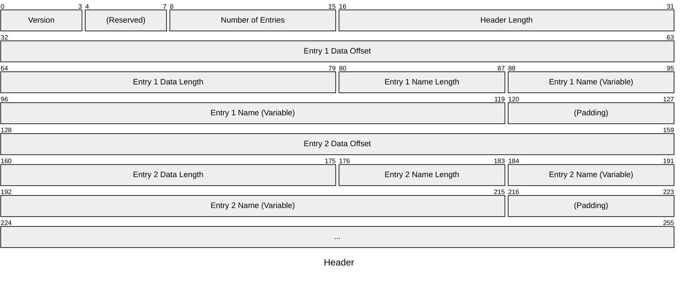

# メタデータストア説明書

メタデータストア(以下、ストア)とは任意のデータを格納することが出来る可変長のデータ領域である。\
制御プログラムにおける定数を再コンパイル無しに編集することで、より円滑な開発を可能とする。

プログラムの邪魔とならないようメモリ末尾に配置される事を想定しており、それ以外の場合は正しく動作しないため注意されたし。

## 目次

- [用語](#%E7%94%A8%E8%AA%9E)
- [構造](#%E6%A7%8B%E9%80%A0)
  - [ヘッダ領域](#%E3%83%98%E3%83%83%E3%83%80%E9%A0%98%E5%9F%9F)
  - [データ領域](#%E3%83%87%E3%83%BC%E3%82%BF%E9%A0%98%E5%9F%9F)
  - [フッタ領域](#%E3%83%95%E3%83%83%E3%82%BF%E9%A0%98%E5%9F%9F)

## 用語

- ストア
  - 本書で解説しているデータ領域全体の名称
- エントリ
  - ストアに格納されているデータの単位

## 構造

ストアの構造は大きくヘッダ領域、データ領域、フッタ領域の3つに分かれる。\
この内、ヘッダ領域とフッタ領域は必須である。

### ヘッダ領域

ヘッダ領域はストア自体の情報とストアに含まれるデータの名前・長さ・位置を記録している。

`Version`は準拠するストア仕様のバージョンである。現時点では`1`のみである。\
`Number of Entries`はエントリ数である。\
`Header Length`はヘッダ長である。リトルエンディアンで、単位はバイトである。\
`Entry N Data Offset`はエントリの実際のデータの先頭位置である。リトルエンディアンで、単位はバイトであり、データ領域の先頭を`0x00000000`と置く。\
`Entry N Data Length`はエントリの実際のデータの長さである。リトルエンディアンで、単位はバイトである。\
`Entry N Name Length`はエントリの名称の長さである。\
`Entry N Name`はエントリの名称である。エンコーディングはUTF-8とする。格納した結果32bit境界に達しない場合は32bit境界まで`0`でパディングする必要がある。

### データ領域

データ領域は実際のデータを格納している。データの形式に制限はなく、任意のデータを格納することが出来る。

ヘッダ領域を読み取り、`Entry N Data Offset`から`Entry N Data Length`バイト読み取ることでデータを取り出すことが出来る。

### フッタ領域

フッタ領域はストアの大きさをバイト単位で格納している。数値は符号なし32bit整数且つリトルエンディアンで格納されている必要がある。

この値から4を引き、フッタ領域の先頭アドレスからその値を引いたものがストアの先頭アドレスである。
